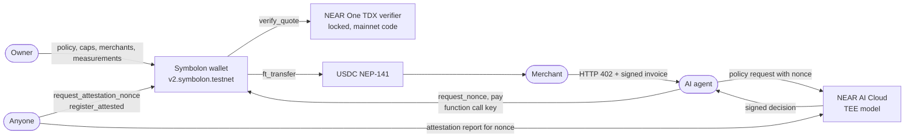
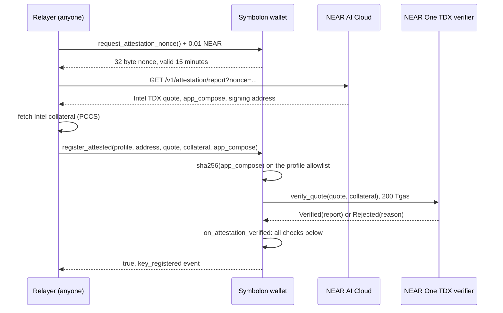
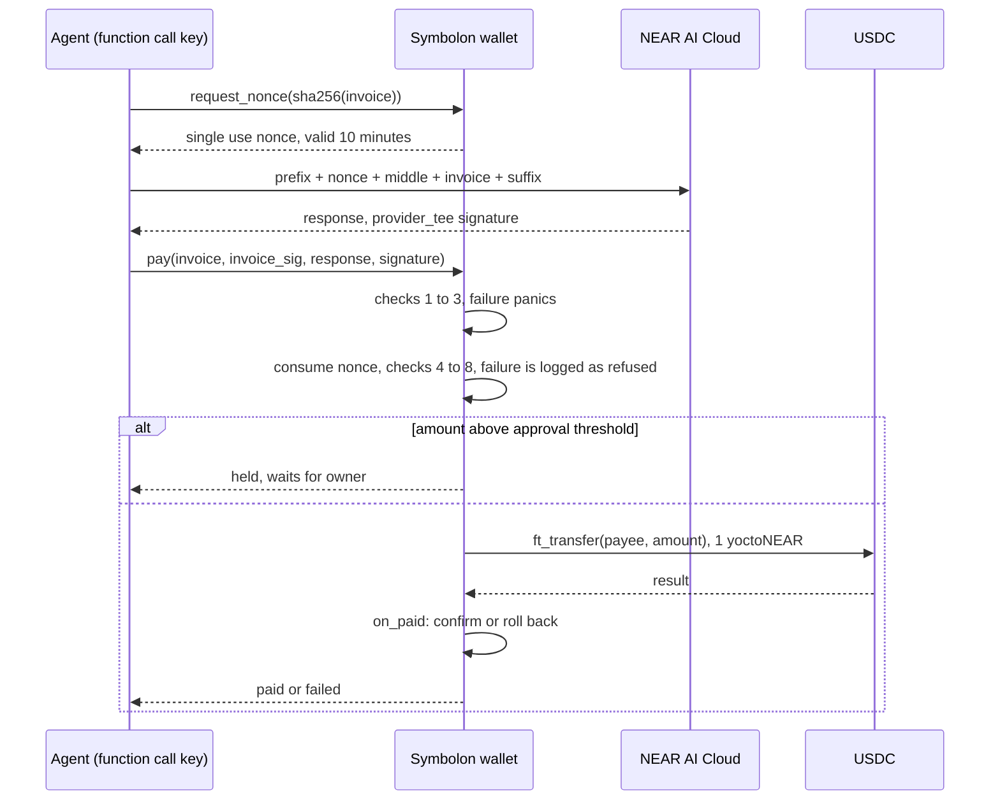
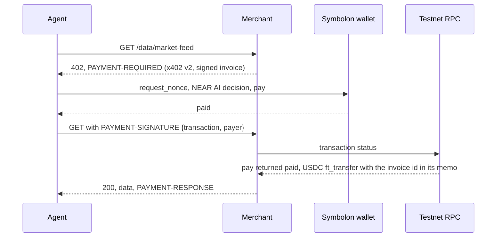

# Symbolon

An AI agent can spend from this wallet only within the owner's limits, only when an AI model approved the payment, and only after the blockchain itself checked that the model's signing key is held by genuine Intel secure hardware running software the owner approved.

Symbolon is a NEAR contract wallet for AI agents. It pays a merchant in USDC only when a NEAR AI Cloud model approved that exact invoice, and only if the model's signing key was proven on chain, through NEAR One's TDX attestation verifier, to live inside a genuine Intel TDX enclave running a configuration the owner allowlisted.

Tracks: AI Security & Defense, Agent Economy. Network: NEAR testnet.

Live evidence: [deployments](docs/deployments.md), [attacks](docs/attacks-testnet.md), [HTTP 402 agent and merchant](docs/agent-merchant.md).

## Terms

| Term | Meaning |
| --- | --- |
| TEE | Trusted execution environment: hardware that runs code so that even the machine's operator cannot read or change it |
| Intel TDX | Intel's TEE for whole virtual machines. NEAR AI runs its models inside TDX |
| Quote | A report signed by the Intel chip that states which code the TDX machine is running and carries 64 bytes chosen by that code (`report_data`) |
| Collateral | Intel's certificates, revocation lists and firmware status data, needed to check a quote |
| TCB status | Intel's verdict on whether the machine's firmware is current, for example `UpToDate` |
| Measurements | Hashes of the machine's boot image and configuration (`mr_td`, `rt_mr0` to `rt_mr2`) |
| `app_compose` | The file that lists the containers the machine runs. Its sha256 is the compose hash |
| Attested key | A NEAR AI signing key that this contract accepted after checking a fresh quote for it |
| Function call key | A NEAR access key that can call only named methods on one contract and cannot attach NEAR |

## Problem

NEAR AI Cloud signs every response with `{model_id}:{sha256(request)}:{sha256(response)}`. That signature alone authorizes nothing:

- Every customer of a model receives signatures from the same key. NEAR AI's documentation: "Instances of the same model share one signing key." Anyone can obtain a genuine `approve: true` by sending their own prompt.
- A contract that accepts signatures must decide which key to trust. If the owner registers that key after an off chain check, the chain trusts the owner, not the hardware.

Agents that hold money are attacked through the model path. A study of 428 LLM routers ([arXiv 2604.08407](https://arxiv.org/html/2604.08407v1)) found 9 injecting malicious code, 17 touching planted AWS credentials and 1 draining ETH from a planted key. A prompt injection made a Grok linked trading agent transfer about $150K to $200K in tokens ([AIID 1556](https://incidentdatabase.ai/cite/1556/)).

Symbolon closes both gaps in the contract itself:

1. The contract registers a model key only after NEAR One's on chain verifier accepts the Intel quote and the contract's own checks bind that key to an enclave configuration the owner allowlisted.
2. The contract rebuilds the exact request bytes the model must have seen, so a genuine signature over any other request is useless.

## Architecture



The agent never holds a key that can move funds by itself. It holds a function call key limited to `request_nonce` and `pay` on the wallet.

## Key registration



Checks run in `on_attestation_verified` on the verifier's answer. Byte layouts follow NEAR AI's [quote, nonce and signer bindings](https://docs.near.ai/cloud/verification/reference/quote-nonce-signer.md).

| Check | Rule |
| --- | --- |
| Verifier result | `Verified`; `Rejected` or a failed call is refused |
| TCB status | in the owner's accepted list, default `UpToDate` |
| Report type | TDX (TD10, TD15 or TD15Ex); SGX is refused |
| Debug mode | bit 0 of `td_attributes` is 0 |
| Signer binding | `report_data[0..32]` equals the 20 byte signing address zero padded to 32 bytes |
| Freshness | `report_data[32..64]` equals a nonce this contract issued, unused and unexpired |
| Configuration | `mr_config_id` equals `0x01 ‖ sha256(app_compose) ‖ 15 zero bytes` |
| Measurements | `mr_td`, `rt_mr0`, `rt_mr1`, `rt_mr2` and the compose hash are each on the profile's allowlist |

A key stays valid while it is unexpired (owner set lifetime, 30 days on testnet), not revoked, its TCB status is still in the accepted list, and every measurement it was attested with is still on the allowlist. Narrowing the TCB list, removing a measurement or removing a profile invalidates existing keys at once. `revoke_key` blocks the address from registering again until `unrevoke_key`. A failed registration never uses up a valid nonce.

## Payment



Checks inside `pay`, in order:

| # | Check | On failure |
| --- | --- | --- |
| 1 | Caller is the wallet itself, signed by the registered agent key; wallet not frozen | panic |
| 2 | Invoice format, expiry, payee allowlisted, `ed25519_verify` with the merchant's key | panic |
| 3 | A nonce exists for `sha256(invoice)` and is unexpired; it is consumed | panic |
| 4 | Rebuild `request = prefix + nonce + middle + invoice + suffix` from the owner's template | refused |
| 5 | Recover the signer of the NEAR AI signature over `{model_id}:{sha256(request)}:{sha256(response)}`; it must be a valid registered key under the template's profile | refused |
| 6 | `choices[0].message.content` parses as the decision object with `approve: true` | refused |
| 7 | Decision payee, amount and invoice id equal the invoice | refused |
| 8 | Merchant cap, per payment cap, invoice not already paid or pending, and today's spent plus pending plus amount within the daily cap | refused |

A refusal after step 3 returns `refused: <reason>`, emits `payment_refused` and keeps the nonce consumed. A refusal at steps 5 to 7 (signature or decision) is final: the invoice is recorded and `request_nonce` refuses it afterwards, so a refused invoice cannot be submitted to the wallet again. A cap refusal at step 8 is not final, because the owner can change caps. This does not stop a compromised agent from asking the model several times off chain with one nonce and submitting only an approving answer, or from obtaining new invoices from a merchant and asking again; each payment is still bounded by the merchant allowlist and the caps.

The daily window is the UTC day (`block_timestamp_ms / 86_400_000`). Spending resets at UTC midnight, so up to twice `per_day` can be spent across midnight.

Signature recovery, as NEAR AI signs it (secp256k1, EIP-191):

```text
text   = model_id + ":" + hex(sha256(request)) + ":" + hex(sha256(response))
digest = keccak256("\x19Ethereum Signed Message:\n" + len(text) + text)
sig    = 65 bytes r ‖ s ‖ v, v in {27, 28}, sent as 0x hex
pubkey = env::ecrecover(digest, r ‖ s, v - 27, malleability_flag = true)
signer = keccak256(pubkey)[12..32]
```

Formats:

| Item | Format |
| --- | --- |
| Invoice | `inv1\|id=<16 hex>\|payee=<account>\|amount=<USDC base units>\|token=usdc\|exp=<unix seconds>\|memo=<up to 64 letters, digits, spaces>`, at most 300 bytes, only letters, digits, space and `\|=._:-`, signed with the merchant's ed25519 key |
| Decision | `{"approve": bool, "payee": string, "amount": string, "invoice_id": string}`, no other fields |
| Template | owner set `model_id`, `profile`, `prefix`, `middle`, `suffix`; `set_policy_template` rejects a template that is not valid JSON around a sample nonce and invoice |

The testnet template ([spec/policy-testnet.json](spec/policy-testnet.json)) asks `z-ai/glm-5.3-flash` for a strict JSON schema answer with `reasoning_effort: "low"`. The agent sends it without streaming, with `Accept-Encoding: identity` and `x-no-aliasing: true`, so NEAR AI signs inside the model's TEE (`provider_tee`) and the hashes match the exact bytes.

## HTTP 402 purchase



| x402 v2 field | Value |
| --- | --- |
| `scheme` | `symbolon-attested` |
| `network` | `near:testnet` |
| `asset` | USDC contract account |
| `payTo` | merchant account |
| `extra.paymentFlow` | `upfront`: the client pays before the resource runs |
| `extra.symbolon` | signed invoice and wallet account |
| `payload` | `{ transaction, payer }` |

This is a custom scheme over the spec's headers and `upfront` flow. The merged NEAR `exact` scheme requires a delegate action signed by a full access key of the paying account, which would bypass every check above.

The merchant keeps no state for unpaid invoices. It checks its own ed25519 signature on the invoice returned in the proof, then reads the transaction from RPC: either a `pay` call signed by the payer's wallet, or an `approve_held` call on the payer's wallet (proof `payload.signer` names the owner), that returned `paid` and contains an `ft_transfer` event emitted by the USDC contract from the payer to the merchant for the invoice amount with memo `symbolon invoice <id>`. Each invoice is served once, including under concurrent requests and across restarts: served invoice ids are appended to a file (`~/.symbolon/merchant-served.txt`, or `SERVED_FILE`) before the data is sent. A proof sent after the invoice's `exp` is still accepted for one day, because the wallet already checked `exp` when it paid; after that it is refused.

## Verify

No keys or accounts needed. Requires `rustup` (the pinned Rust 1.95.0 installs from `rust-toolchain.toml`), `curl`, `python3` and network access. The tests take about 3 minutes on a machine with warm caches. A fresh clone first compiles cargo-near and the dependencies and downloads near-sandbox.

1. Install the build tool and build every contract.

   ```
   git clone https://github.com/0d1026/Symbolon.git
   cd Symbolon
   cargo install cargo-near@0.23.0 --locked
   ./scripts/build.sh
   ```

   See four wasm files: `target/near/symbolon.wasm` (production), `target/near/test/symbolon.wasm` (sandbox nonce hook), `target/near/mock/mock_verifier.wasm`, `target/near/usdc/mock_usdc.wasm`.

2. Run the tests.

   ```
   cd contract
   RUST_TEST_THREADS=3 cargo test
   ```

   See 56 tests pass: 6 unit, 25 registry, 1 migration, 4 mock verifier, 11 payment and 9 payment ownership. The registry and payment tests run NEAR One's verifier at the exact code deployed on mainnet (code hash `6RHv9Er2kDegVjCDcHaBvpbgjmgq5nAHodyBiHC4gZpa`) against real NEAR AI quotes and real signed NEAR AI decisions captured on 2026-11-07. The captured Intel collateral is valid until 2026-12-06.

3. Check the live testnet wallet. The `args_base64` value is `{"address":"0x3b753b4406613c5e70ae640508632b600424fa0c","profile":"z-ai/glm-5.3-flash"}`.

   ```
   curl -s https://rpc.testnet.near.org -H 'Content-Type: application/json' -d '{"jsonrpc":"2.0","id":1,"method":"query","params":{"request_type":"call_function","finality":"final","account_id":"v2.symbolon.testnet","method_name":"is_key_valid","args_base64":"eyJhZGRyZXNzIjoiMHgzYjc1M2I0NDA2NjEzYzVlNzBhZTY0MDUwODYzMmI2MDA0MjRmYTBjIiwicHJvZmlsZSI6InotYWkvZ2xtLTUuMy1mbGFzaCJ9"}}' | python3 -c "import sys,json;print(bytes(json.load(sys.stdin)['result']['result']).decode())"
   ```

   See `true`: the NEAR AI model key is registered through the verifier.

4. Check the verifier copy is the mainnet code and locked.

   ```
   curl -s https://rpc.testnet.near.org -H 'Content-Type: application/json' -d '{"jsonrpc":"2.0","id":1,"method":"query","params":{"request_type":"view_account","finality":"final","account_id":"tee-verifier.symbolon.testnet"}}'
   curl -s https://rpc.testnet.near.org -H 'Content-Type: application/json' -d '{"jsonrpc":"2.0","id":1,"method":"query","params":{"request_type":"view_access_key_list","finality":"final","account_id":"tee-verifier.symbolon.testnet"}}'
   ```

   See `code_hash` `6RHv9Er2kDegVjCDcHaBvpbgjmgq5nAHodyBiHC4gZpa` and an empty `keys` list.

## Live proof on testnet

| Account | Role |
| --- | --- |
| `v2.symbolon.testnet` | Symbolon wallet, production build |
| `tee-verifier.symbolon.testnet` | NEAR One TDX verifier, mainnet code, locked |
| `symbolon-usdc.testnet` | Mock USDC, NEP-141, 6 decimals |
| `symbolon-merchant.testnet` | Merchant |
| `symbolon.testnet` | Owner |

NEAR One's verifier is `tee-verifier-2026-08-04.near` on mainnet and has no testnet deployment under that name, so testnet uses a locked copy with the identical code hash.

| Event | Transaction |
| --- | --- |
| Wallet upgraded in place, `migrate` in the same transaction, state unchanged | `7aaxykzmYNbipm3hczGenfn9J1VA8ue5hruhgrtf8SrH` |
| Model key `0x3b75…fa0c` registered through the verifier, valid to 2026-12-08 | `4wi6DGRzTxii67rrXiU7944JekDeuySVVm5Lj1VBoxbz` |
| Gateway key `0xb98a…e779` registered through the verifier, valid to 2026-12-08 | `LxLKsMgno5hXMF3kePZXBeesuQbr4NcqS8YbcbqKT7a` |
| Payment, 2 USDC | `BmjpZZ6iXAxK9KvX4fxTxK9YNE1ovxUumogGhe3N7YMc` |
| Forged approval refused | `4K3FyWkTVmePfbVo7NLgAN7HCDCYXr6xTk9LchThjYNB` |
| Prompt injected payment to attacker refused | `9KPhvQXEmPe7peVXCGaehgKaqhwStdgwjEhrRcyGNduF` |
| Held 50 USDC payment approved by owner | `3MHZRQvwBwiEFxVLStEYkdRsriwJ7EqhKSuTJY8cZBNF` |
| HTTP 402 purchase | `2kj5MfBXPovzF39nCWQqxRNJ7ESc7QPxGSG2rWNmhox5` |

Full tables: [deployments](docs/deployments.md), [attacks](docs/attacks-testnet.md), [agent and merchant](docs/agent-merchant.md). Open a transaction at `https://testnet.nearblocks.io/txns/<id>`.

## Contract interface

Registry (`contract/src/lib.rs`):

| Method | Caller | Effect |
| --- | --- | --- |
| `request_attestation_nonce()` | anyone, 0.01 NEAR | issues a 32 byte nonce valid 15 minutes, prunes up to 2 expired |
| `register_attested(profile, signing_address, quote, collateral, app_compose)` | anyone, borsh args, at least 240 Tgas | compose hash precheck, `verify_quote`, then `on_attestation_verified` |
| `prune_expired_nonces(limit)` | anyone | removes up to 100 expired nonces |
| `set_profile`, `remove_profile` | owner | measurement allowlist per profile |
| `set_accepted_tcb_statuses`, `set_key_ttl_ms`, `set_verifier` | owner | registry policy |
| `revoke_key`, `unrevoke_key` | owner | remove a key and block it from registering, or lift the block |
| `propose_owner`, `accept_owner` | owner, then proposed owner | two step ownership transfer |
| `get_key`, `is_key_valid`, `get_profile`, `get_config`, `get_pending_owner` | view | |

Payments (`contract/src/pay.rs`):

| Method | Caller | Effect |
| --- | --- | --- |
| `request_nonce(invoice_hash)` | agent key | single use nonce for one invoice, valid 10 minutes, at most 32 live |
| `pay(invoice, invoice_sig, response, signature)` | agent key, borsh args, at least 40 Tgas | returns `paid`, `failed`, `held:<id>` or `refused: <reason>` |
| `approve_held(held_id)`, `reject_held(held_id)` | owner | pays or releases a held payment |
| `set_agent_key(public_key, allowance)` | owner | adds the agent function call key, deletes the previous one |
| `set_policy_template`, `add_merchant`, `remove_merchant`, `set_caps` | owner | `add_merchant` forwards any deposit as the merchant's USDC `storage_deposit` |
| `freeze`, `unfreeze` | owner | stops `request_nonce`, `pay` and `approve_held` |
| `update_contract()` | owner, at least 150 Tgas | deploys the raw wasm passed as input and calls the new code's `migrate` in the same receipt; if `migrate` fails the deploy is undone |
| `migrate()` | the wallet itself | reads the current state layout, or the layout of the build first deployed at `v2.symbolon.testnet`, and adds new fields |
| `get_policy_template`, `get_merchant`, `get_caps`, `get_spend_window`, `get_held`, `get_agent_key`, `is_frozen`, `is_settled` | view | |

Events follow NEP-297 with `standard: "symbolon"`: `nonce_issued`, `key_registered`, `key_rejected`, `key_revoked`, `key_unrevoked`, `pay_nonce_issued`, `payment_sent`, `payment_completed`, `payment_failed`, `payment_held`, `payment_refused`, `held_approved`, `held_rejected` and owner configuration events. Events carry hashes and ids, never request or response bodies.

## Agent key limits

The agent holds one NEAR function call access key on the wallet account, installed by the owner with `set_agent_key`.

| Property | Value | Enforced by |
| --- | --- | --- |
| Receiver | the wallet only | NEAR protocol: `ReceiverMismatch` |
| Methods | `request_nonce`, `pay` | NEAR protocol: `MethodNameMismatch` |
| Deposit | none | NEAR protocol: `DepositWithFunctionCall` |
| Gas allowance | 1 NEAR on testnet | NEAR protocol |
| Caller check | `pay` and `request_nonce` require predecessor = wallet and signer key = registered agent key | contract |

A stolen agent key can request nonces (at most 32 live) and submit payments, but a payment only succeeds for an invoice signed by an allowlisted merchant, approved by an attested model over the owner's template, and within the caps. It can also spend its own gas allowance on failing calls. When the allowance is spent the key stops working; the owner installs a new key with `set_agent_key`, which also deletes the old one. The owner can `freeze` the wallet at any time.

Testnet note: `v2.symbolon.testnet` still has its deployment full access key, used for the in place upgrade because the first deployed build had no `migrate`. A production wallet deletes it after deployment and upgrades only through the owner's `update_contract`.

## Threat model

| Attack | Stopped by | Test | Live transaction |
| --- | --- | --- | --- |
| Forged decision: genuine `approve: true` from the attacker's own prompt, signed by the attested key | rebuilt request hash differs | `refuses_a_genuinely_signed_decision_for_a_different_request` | `4K3FyWkTVmePfbVo7NLgAN7HCDCYXr6xTk9LchThjYNB` |
| Router edits the response | response hash differs | `refuses_a_tampered_response` | `26W1KmiTaeo9RumXewB7eqriB9MhyGjvFwnZx1PUSNWx` |
| Router edits the request | request hash differs | `refuses_a_decision_built_on_a_different_nonce` | covered by the forged decision |
| Replay | single use nonce; settled invoices | `refuses_to_pay_the_same_invoice_twice` | `DWiHW6Apmc222Pw7YV764udfmXZAmVCYYyiGJQ6kycLo` |
| Key not attested or revoked | registry validity check | `refuses_signatures_from_keys_that_are_not_attested` | |
| Fake or unlisted enclave key registration | verifier, report data, nonce, measurements | 25 registry tests | |
| Stolen agent key | access key rules, allowlist, merchant signature | `only_the_agent_function_call_key_can_pay`, `agent_key_cannot_call_owner_methods_or_attach_deposits` | `8vGgRBjWNoEhJLPaDcGm5tGWuyEDQDtbat1bCjVfmtS5` |
| Prompt injected agent pays an attacker | merchant allowlist | `invoice_checks_run_before_any_nonce_is_used` | `9KPhvQXEmPe7peVXCGaehgKaqhwStdgwjEhrRcyGNduF` |
| Prompt injected agent buys outside the mandate | policy model refusal | `refuses_when_the_model_refuses_and_blocks_the_invoice` | `5TebcEdYhoKzoWkZFKC6vAFnruvPwZxFgzHSbpchzseP` |
| Large payment | approval threshold, owner decides | `holds_a_large_payment_until_the_owner_approves` | `AVvnPYm478TALVDzczJnLWHzvwVi5U5puFEa5ZTnHQ5a` |
| Failed transfer | `on_paid` rolls back pending and settled state | `failed_transfer_rolls_back_the_reservation` | |
| Gateway or non TEE signature | the contract builds the three part `provider_tee` text itself; a gateway signature covers a different two part text and recovers to another address | no test with a real gateway signature; an unregistered signer is covered by `refuses_signatures_from_keys_that_are_not_attested` | |
| Upgrade that cannot read the state | `migrate` runs in the same receipt as the deploy | `upgrade_runs_migrate_and_rolls_back_bad_code`, `deployed_v2_state_migrates_to_the_current_build` | `7aaxykzmYNbipm3hczGenfn9J1VA8ue5hruhgrtf8SrH` |

Bounded, not prevented:

- An allowlisted merchant can place text in its own invoice memo. The character set and 64 byte limit keep it from breaking the request JSON; the caps bound the loss.
- An agent fooled into requesting a valid invoice from an allowlisted merchant for an allowed item can spend up to the caps.
- The owner can approve a held payment after removing its merchant or lowering the caps; `approve_held` rechecks only the freeze and the daily budget. Held payments do not expire.
- A final refusal blocks that invoice even when the cause was not the model, for example a router that edited the response or a key that had just expired. The merchant then issues a new invoice.

## Trust assumptions and limits

- **Gateway.** NEAR AI's gateway hashes the client's request bytes and passes that hash to the model TEE, which signs it. The model TEE does not recompute it. The gateway key can be registered under its own profile (done on testnet), but the contract does not check a gateway signature per payment.
- **Shared model key.** One key serves every instance of a model. Registration proves the key lives in at least one enclave with allowlisted measurements, not that every instance holding it does.
- **Not checked on chain.** NVIDIA GPU evidence and RTMR3 event log replay. The configuration is bound through `mr_config_id`.
- **Measurement policy.** NEAR AI publishes no reference values. The owner must read the `app_compose` behind a compose hash before allowlisting it. On testnet the owner allowlisted the measurements from the live attestation report.
- **Collateral age.** The verifier checks Intel collateral against block time. Test fixtures expire on 2026-12-06 and are recaptured with `scripts/capture_attestation.py`.
- **USDC.** Testnet uses a mock NEP-141 token with 6 decimals. Mainnet USDC is Circle's contract.

## NEAR features used

| Feature | Use |
| --- | --- |
| NEAR One TDX attestation verifier (`verify_quote`) | on chain Intel DCAP verification of NEAR AI enclaves |
| Function call access keys | the agent key, limited to two methods with no deposits |
| `env::ecrecover`, `env::keccak256_array` | EIP-191 recovery of NEAR AI ECDSA signatures (`unstable` feature) |
| `env::ed25519_verify` | merchant invoice signatures |
| `env::sha256_array` | request and response hashes, compose hash, nonces |
| Promises and callbacks | `verify_quote` then `on_attestation_verified`; `ft_transfer` then `on_paid` |
| NEP-141 | USDC transfers and storage registration |
| NEP-297 | contract events |
| NEAR AI Cloud | TEE model inference, `provider_tee` response signatures, attestation reports |

## Build, test and deploy

| Tool | Version |
| --- | --- |
| Rust | 1.95.0, `wasm32-unknown-unknown` |
| near-sdk, near-contract-standards | 5.30.1 |
| cargo-near | 0.23.0 |
| near-workspaces | 0.24.0 |
| near-cli-rs | 0.31.1 |
| near-api-js | 7.4.0 |
| Node.js | 20 |

```
./scripts/build.sh
cd contract && RUST_TEST_THREADS=3 cargo test
```

Live scripts read keys from outside the repository: `~/.nearai.env` holds `NEAR_AI_CLOUD_API_KEY`, and `~/.symbolon/` holds the agent access key and invoice signing keys.

| Script | Purpose |
| --- | --- |
| `scripts/capture_attestation.py <out.json> [nonce]` | fetch a NEAR AI attestation report and Intel collateral for a nonce |
| `scripts/register_args.py <capture.json> model\|gateway profile\|register <profile>` | build `set_profile` JSON or `register_attested` borsh args |
| `scripts/capture_decisions.mjs <out.json>` | capture signed NEAR AI decisions for the sandbox tests |
| `scripts/live_pay.mjs <amount> "<memo>"` | one live payment on testnet |
| `scripts/attacks.mjs <attack\|all>` | live attacks on testnet, results in `docs/attacks-testnet.json` |
| `app/` | TypeScript agent, merchant and merchant checks; see [agent and merchant](docs/agent-merchant.md) |

Deploying a wallet, as done for `v2.symbolon.testnet`:

```
near contract deploy <wallet> use-file target/near/symbolon.wasm with-init-call new json-args '{"owner":"<owner>","verifier":"<verifier>","key_ttl_ms":2592000000,"usdc":"<usdc>"}' prepaid-gas '100 Tgas' attached-deposit '0 NEAR' network-config testnet sign-with-keychain send
```

Then, as the owner: `set_profile`, a registration through `request_attestation_nonce` and `register_attested`, `set_policy_template`, `add_merchant` with a USDC storage deposit and 50 Tgas, `set_caps`, `set_agent_key`, and a USDC `storage_deposit` plus `ft_transfer` to fund the wallet. Every transaction is listed in [deployments](docs/deployments.md).

## Repository

| Path | Contents |
| --- | --- |
| `contract/src/lib.rs` | attested key registry |
| `contract/src/pay.rs` | payment path |
| `contract/src/verifier.rs` | borsh types of NEAR One's verifier, matched byte for byte against the deployed contract |
| `contract/tests/` | sandbox tests and fixtures: verifier wasm, attestation reports, signed decisions |
| `mock-verifier/` | sandbox only verifier that returns a preset answer |
| `mock-usdc/` | NEP-141 USDC stand in for sandbox and testnet |
| `app/` | TypeScript agent, merchant and checks |
| `scripts/` | build, capture, registration, live payment and attack scripts |
| `spec/` | owner policy templates for sandbox and testnet |
| `docs/` | deployments, attacks, agent and merchant evidence |

## Credits and license

Built during NEAR HACKATHON, 2026-11-05 onward. Libraries: near-sdk, near-contract-standards, near-workspaces, cargo-near, near-api-js, borsh, hex, sha2, tokio, tsx and TypeScript; Phala's dcap-qvl in the attestation capture script; NEAR One's `tee-verifier` contract, used unmodified. Code and documentation were written with AI coding assistance (Claude Code) and reviewed by the team.

Apache 2.0. See [LICENSE](LICENSE).
