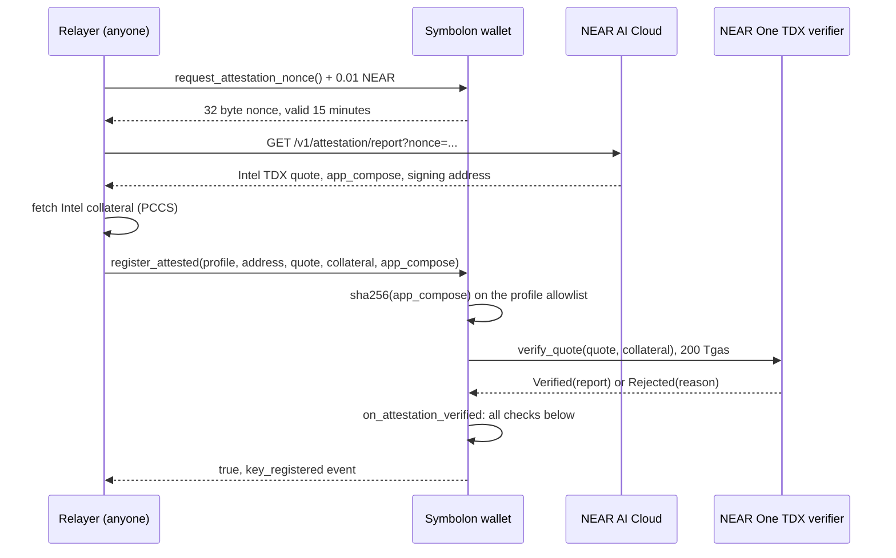
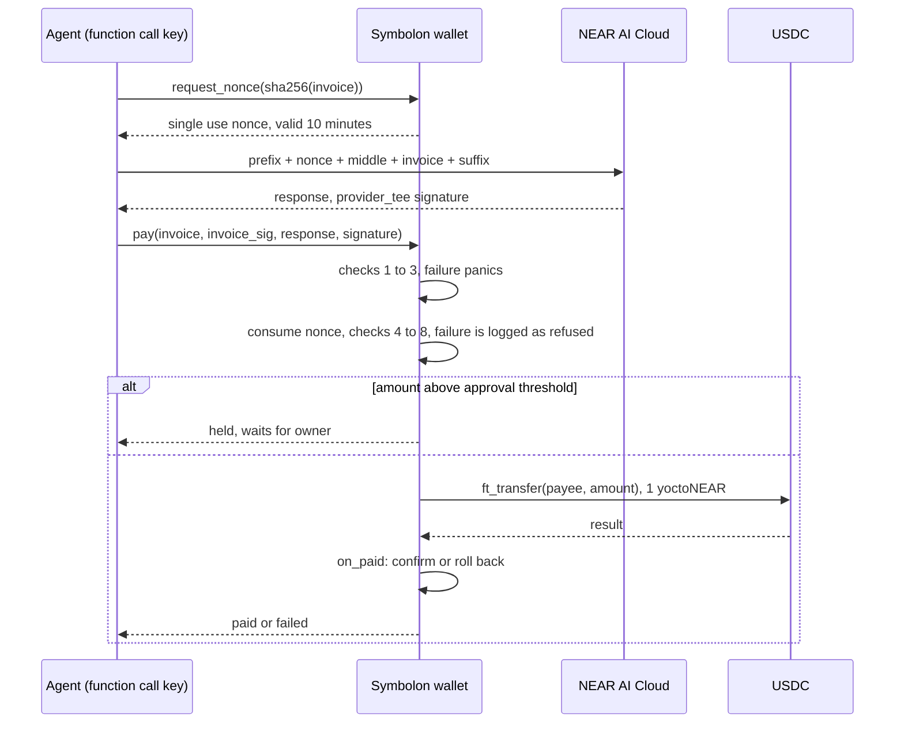
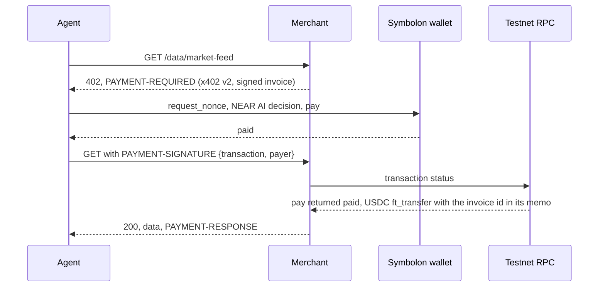

# Design

How the Symbolon contract checks keys and payments. Start with the [README](../README.md).

## Terms

| Term | Meaning |
| --- | --- |
| TEE | Trusted execution environment: hardware that runs code so that even the machine's operator cannot read or change it |
| Intel TDX | Intel's TEE for whole virtual machines. NEAR AI runs its models inside TDX |
| Quote | A report signed by the Intel chip that states which code the TDX machine is running and carries 64 bytes chosen by that code (`report_data`) |
| Collateral | Intel's certificates, revocation lists and firmware status data, needed to check a quote |
| TCB status | Intel's verdict on whether the machine's firmware is current, for example `UpToDate` |
| Measurements | Hashes of the machine's boot image and configuration (`mr_td`, `rt_mr0` to `rt_mr2`) |
| `app_compose` | The file that lists the containers the machine runs. Its sha256 is the compose hash |
| Attested key | A NEAR AI signing key that this contract accepted after checking a fresh quote for it |
| Function call key | A NEAR access key that can call only named methods on one contract and cannot attach NEAR |

## Key registration



Checks run in `on_attestation_verified` on the verifier's answer. Byte layouts follow NEAR AI's [quote, nonce and signer bindings](https://docs.near.ai/cloud/verification/reference/quote-nonce-signer.md).

| Check | Rule |
| --- | --- |
| Verifier result | `Verified`; `Rejected` or a failed call is refused |
| TCB status | in the owner's accepted list, default `UpToDate` |
| Report type | TDX (TD10, TD15 or TD15Ex); SGX is refused |
| Debug mode | bit 0 of `td_attributes` is 0 |
| Signer binding | `report_data[0..32]` equals the 20 byte signing address zero padded to 32 bytes |
| Freshness | `report_data[32..64]` equals a nonce this contract issued, unused and unexpired |
| Configuration | `mr_config_id` equals `0x01 ‖ sha256(app_compose) ‖ 15 zero bytes` |
| Measurements | `mr_td`, `rt_mr0`, `rt_mr1`, `rt_mr2` and the compose hash are each on the profile's allowlist |

A key stays valid while it is unexpired (owner set lifetime, 30 days on testnet), not revoked, its TCB status is still in the accepted list, and every measurement it was attested with is still on the allowlist. Narrowing the TCB list, removing a measurement or removing a profile invalidates existing keys at once. `revoke_key` blocks the address from registering again until `unrevoke_key`. A failed registration never uses up a valid nonce.

## Payment



Checks inside `pay`, in order:

| # | Check | On failure |
| --- | --- | --- |
| 1 | Caller is the wallet itself, signed by the registered agent key; wallet not frozen | panic |
| 2 | Invoice format, expiry, payee allowlisted, `ed25519_verify` with the merchant's key | panic |
| 3 | A nonce exists for `sha256(invoice)` and is unexpired; it is consumed | panic |
| 4 | Rebuild `request = prefix + nonce + middle + invoice + suffix` from the owner's template | refused |
| 5 | Recover the signer of the NEAR AI signature over `{model_id}:{sha256(request)}:{sha256(response)}`; it must be a valid registered key under the template's profile | refused |
| 6 | `choices[0].message.content` parses as the decision object with `approve: true` | refused |
| 7 | Decision payee, amount and invoice id equal the invoice | refused |
| 8 | Merchant cap, per payment cap, invoice not already paid or pending, and today's spent plus pending plus amount within the daily cap | refused |

A refusal after step 3 returns `refused: <reason>`, emits `payment_refused` and keeps the nonce consumed. A refusal at steps 5 to 7 (signature or decision) is final: the invoice is recorded and `request_nonce` refuses it afterwards, so a refused invoice cannot be submitted to the wallet again. A cap refusal at step 8 is not final, because the owner can change caps. This does not stop a compromised agent from asking the model several times off chain with one nonce and submitting only an approving answer, or from obtaining new invoices from a merchant and asking again; each payment is still bounded by the merchant allowlist and the caps.

The daily window is the UTC day (`block_timestamp_ms / 86_400_000`). Spending resets at UTC midnight, so up to twice `per_day` can be spent across midnight.

Signature recovery, as NEAR AI signs it (secp256k1, EIP-191):

```text
text   = model_id + ":" + hex(sha256(request)) + ":" + hex(sha256(response))
digest = keccak256("\x19Ethereum Signed Message:\n" + len(text) + text)
sig    = 65 bytes r ‖ s ‖ v, v in {27, 28}, sent as 0x hex
pubkey = env::ecrecover(digest, r ‖ s, v - 27, malleability_flag = true)
signer = keccak256(pubkey)[12..32]
```

Formats:

| Item | Format |
| --- | --- |
| Invoice | `inv1\|id=<16 hex>\|payee=<account>\|amount=<USDC base units>\|token=usdc\|exp=<unix seconds>\|memo=<up to 64 letters, digits, spaces>`, at most 300 bytes, only letters, digits, space and `\|=._:-`, signed with the merchant's ed25519 key |
| Decision | `{"approve": bool, "payee": string, "amount": string, "invoice_id": string}`, no other fields |
| Template | owner set `model_id`, `profile`, `prefix`, `middle`, `suffix`; `set_policy_template` rejects a template that is not valid JSON around a sample nonce and invoice |

The testnet template ([spec/policy-testnet.json](../spec/policy-testnet.json)) asks `z-ai/glm-5.3-flash` for a strict JSON schema answer with `reasoning_effort: "low"`. The agent sends it without streaming, with `Accept-Encoding: identity` and `x-no-aliasing: true`, so NEAR AI signs inside the model's TEE (`provider_tee`) and the hashes match the exact bytes.

## HTTP 402 purchase



| x402 v2 field | Value |
| --- | --- |
| `scheme` | `symbolon-attested` |
| `network` | `near:testnet` |
| `asset` | USDC contract account |
| `payTo` | merchant account |
| `extra.paymentFlow` | `upfront`: the client pays before the resource runs |
| `extra.symbolon` | signed invoice and wallet account |
| `payload` | `{ transaction, payer }` |

This is a custom scheme over the spec's headers and `upfront` flow. The merged NEAR `exact` scheme requires a delegate action signed by a full access key of the paying account, which would bypass every check above.

The merchant keeps no state for unpaid invoices. It checks its own ed25519 signature on the invoice returned in the proof, then reads the transaction from RPC: either a `pay` call signed by the payer's wallet, or an `approve_held` call on the payer's wallet (proof `payload.signer` names the owner), that returned `paid` and contains an `ft_transfer` event emitted by the USDC contract from the payer to the merchant for the invoice amount with memo `symbolon invoice <id>`. Each invoice is served once, including under concurrent requests and across restarts: served invoice ids are appended to a file (`~/.symbolon/merchant-served.txt`, or `SERVED_FILE`) before the data is sent. A proof sent after the invoice's `exp` is still accepted for one day, because the wallet already checked `exp` when it paid; after that it is refused.

## Contract interface

Registry (`contract/src/lib.rs`):

| Method | Caller | Effect |
| --- | --- | --- |
| `request_attestation_nonce()` | anyone, 0.01 NEAR | issues a 32 byte nonce valid 15 minutes, prunes up to 2 expired |
| `register_attested(profile, signing_address, quote, collateral, app_compose)` | anyone, borsh args, at least 240 Tgas | compose hash precheck, `verify_quote`, then `on_attestation_verified` |
| `prune_expired_nonces(limit)` | anyone | removes up to 100 expired nonces |
| `set_profile`, `remove_profile` | owner | measurement allowlist per profile |
| `set_accepted_tcb_statuses`, `set_key_ttl_ms`, `set_verifier` | owner | registry policy |
| `revoke_key`, `unrevoke_key` | owner | remove a key and block it from registering, or lift the block |
| `propose_owner`, `accept_owner` | owner, then proposed owner | two step ownership transfer |
| `get_key`, `is_key_valid`, `get_profile`, `get_config`, `get_pending_owner` | view | |

Payments (`contract/src/pay.rs`):

| Method | Caller | Effect |
| --- | --- | --- |
| `request_nonce(invoice_hash)` | agent key | single use nonce for one invoice, valid 10 minutes, at most 32 live |
| `pay(invoice, invoice_sig, response, signature)` | agent key, borsh args, at least 40 Tgas | returns `paid`, `failed`, `held:<id>` or `refused: <reason>` |
| `approve_held(held_id)`, `reject_held(held_id)` | owner | pays or releases a held payment |
| `set_agent_key(public_key, allowance)` | owner | adds the agent function call key, deletes the previous one |
| `set_policy_template`, `add_merchant`, `remove_merchant`, `set_caps` | owner | `add_merchant` forwards any deposit as the merchant's USDC `storage_deposit` |
| `freeze`, `unfreeze` | owner | stops `request_nonce`, `pay` and `approve_held` |
| `update_contract()` | owner, at least 150 Tgas | deploys the raw wasm passed as input and calls the new code's `migrate` in the same receipt; if `migrate` fails the deploy is undone |
| `migrate()` | the wallet itself | reads the current state layout, or the layout of the build first deployed at `v2.symbolon.testnet`, and adds new fields |
| `get_policy_template`, `get_merchant`, `get_caps`, `get_spend_window`, `get_held`, `get_agent_key`, `is_frozen`, `is_settled` | view | |

Events follow NEP-297 with `standard: "symbolon"`: `nonce_issued`, `key_registered`, `key_rejected`, `key_revoked`, `key_unrevoked`, `pay_nonce_issued`, `payment_sent`, `payment_completed`, `payment_failed`, `payment_held`, `payment_refused`, `held_approved`, `held_rejected` and owner configuration events. Events carry hashes and ids, never request or response bodies.

## Threat model

| Attack | Stopped by | Test | Live transaction |
| --- | --- | --- | --- |
| Forged decision: genuine `approve: true` from the attacker's own prompt, signed by the attested key | rebuilt request hash differs | `refuses_a_genuinely_signed_decision_for_a_different_request` | `4K3FyWkTVmePfbVo7NLgAN7HCDCYXr6xTk9LchThjYNB` |
| Router edits the response | response hash differs | `refuses_a_tampered_response` | `26W1KmiTaeo9RumXewB7eqriB9MhyGjvFwnZx1PUSNWx` |
| Router edits the request | request hash differs | `refuses_a_decision_built_on_a_different_nonce` | covered by the forged decision |
| Replay | single use nonce; settled invoices | `refuses_to_pay_the_same_invoice_twice` | `DWiHW6Apmc222Pw7YV764udfmXZAmVCYYyiGJQ6kycLo` |
| Key not attested or revoked | registry validity check | `refuses_signatures_from_keys_that_are_not_attested` | |
| Fake or unlisted enclave key registration | verifier, report data, nonce, measurements | 25 registry tests | |
| Stolen agent key | access key rules, allowlist, merchant signature | `only_the_agent_function_call_key_can_pay`, `agent_key_cannot_call_owner_methods_or_attach_deposits` | `8vGgRBjWNoEhJLPaDcGm5tGWuyEDQDtbat1bCjVfmtS5` |
| Prompt injected agent pays an attacker | merchant allowlist | `invoice_checks_run_before_any_nonce_is_used` | `9KPhvQXEmPe7peVXCGaehgKaqhwStdgwjEhrRcyGNduF` |
| Prompt injected agent buys outside the mandate | policy model refusal | `refuses_when_the_model_refuses_and_blocks_the_invoice` | `5TebcEdYhoKzoWkZFKC6vAFnruvPwZxFgzHSbpchzseP` |
| Large payment | approval threshold, owner decides | `holds_a_large_payment_until_the_owner_approves` | `AVvnPYm478TALVDzczJnLWHzvwVi5U5puFEa5ZTnHQ5a` |
| Failed transfer | `on_paid` rolls back pending and settled state | `failed_transfer_rolls_back_the_reservation` | |
| Gateway or non TEE signature | the contract builds the three part `provider_tee` text itself; a gateway signature covers a different two part text and recovers to another address | no test with a real gateway signature; an unregistered signer is covered by `refuses_signatures_from_keys_that_are_not_attested` | |
| Upgrade that cannot read the state | `migrate` runs in the same receipt as the deploy | `upgrade_runs_migrate_and_rolls_back_bad_code`, `deployed_v2_state_migrates_to_the_current_build` | `7aaxykzmYNbipm3hczGenfn9J1VA8ue5hruhgrtf8SrH` |

Bounded, not prevented:

- An allowlisted merchant can place text in its own invoice memo. The character set and 64 byte limit keep it from breaking the request JSON; the caps bound the loss.
- An agent fooled into requesting a valid invoice from an allowlisted merchant for an allowed item can spend up to the caps.
- The owner can approve a held payment after removing its merchant or lowering the caps; `approve_held` rechecks only the freeze and the daily budget. Held payments do not expire.
- A final refusal blocks that invoice even when the cause was not the model, for example a router that edited the response or a key that had just expired. The merchant then issues a new invoice.
